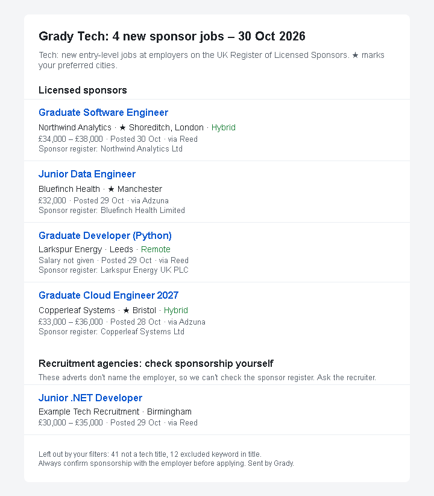
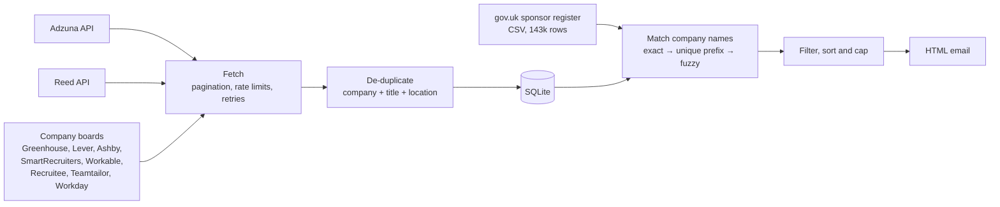

# Grady

[](https://github.com/hjeesum/grady/actions/workflows/tests.yml)

**A daily email of new graduate and junior tech jobs in the UK, only from employers licensed to sponsor visas.**

**Live job page: [hjeesum.github.io/grady](https://hjeesum.github.io/grady/)** (updated every morning, with an [RSS feed](https://hjeesum.github.io/grady/feed.xml)).

## The problem

As an international computer science graduate job hunting in the UK, I need an employer that can sponsor a Skilled Worker visa. Job sites don't let you filter for that. I kept finding a promising role, researching the company, sometimes starting an application, and only then discovering the employer couldn't sponsor me.

The UK government publishes the [Register of Licensed Sponsors](https://www.gov.uk/government/publications/register-of-licensed-sponsors-workers): every organisation allowed to sponsor workers. Grady checks every job against it automatically, so I only spend time on jobs I can actually take.

## What it does

Every morning, a GitHub Actions workflow:

1. **Searches** the Adzuna and Reed job APIs across the whole UK, and the careers sites of about 1,000 companies on the sponsor register.
2. **Removes duplicates**: the same job reposted, or listed on both sites.
3. **Checks each employer** against the 128,000 names on the sponsor register.
4. **Filters** out senior roles, non-tech roles and low salaries.
5. **Emails me** only the jobs I haven't seen before, preferred cities first.



*An example digest. The companies and jobs in this screenshot are made up.*

Recruitment agencies get their own section. Their adverts hide the real employer, so sponsorship can't be checked automatically.

## How it works



| Part | File | Notes |
|---|---|---|
| Job sources | [`adzuna.py`](grady/adzuna.py), [`reed.py`](grady/reed.py), [`nhs_jobs.py`](grady/nhs_jobs.py), [`boards.py`](grady/boards.py) | Official APIs and public feeds, plus employers' own Workday careers sites read politely (slowly, no logins, as robots.txt allows). Never job sites like LinkedIn or Indeed. Each converts results into one `Job` type, so adding a source is one new file. NHS Jobs (Band 5, entry-level roles only) is kept for a healthcare profile but currently unused. |
| HTTP | [`http_utils.py`](grady/http_utils.py), [`ratelimit.py`](grady/ratelimit.py) | Requests spaced 2.5 s apart; 429 and 5xx retried with exponential backoff. API keys never appear in error messages. |
| Storage | [`storage.py`](grady/storage.py) | SQLite with a `UNIQUE(source, source_id)` constraint and versioned schema migrations. |
| Sponsor register | [`sponsors.py`](grady/sponsors.py) | Finds today's CSV through the GOV.UK Content API, since the file name changes with every update. |
| Matching | [`normalise.py`](grady/normalise.py), [`matching.py`](grady/matching.py), [`agencies.py`](grady/agencies.py) | See "Challenges" below. |
| Email | [`digest.py`](grady/digest.py), [`emailer.py`](grady/emailer.py) | Jinja2 template with autoescaping, HTML + plain text, sent over SMTP with STARTTLS. |
| Automation | [`.github/workflows/`](.github/workflows) | Tests on every push; the digest runs daily at 06:37 UTC (off the hour, when GitHub is less busy). |

## Challenges

### 1. Matching company names to the sponsor register

This was the hardest part. A job advert says `Tarmac`; the register says `Tarmac Trading Limited`. An advert says `Leonardo Hotels`; the register has `Leonardo UK Ltd`, a defence company. Get it wrong one way and I miss jobs. Get it wrong the other way and I apply to employers that can't sponsor me, which is the exact problem this project exists to solve.

**Normalising** names (lowercase, strip `Ltd`/`PLC`/`UK` from the end, `&` → `and`) let exact matching find 18 of 74 companies in my real data. To do better, I built a **labelled set of 50 real company names** with the right answer for each. It deliberately includes look-alikes, such as `Express Solicitors` vs `Expert Solicitors`. I then measured each approach against it:

- **rapidfuzz's `token_set_ratio`** matched `A1 Personnel Employment Agency` to a company called just `agency`: 10 or more wrong matches at every threshold.
- **Stripping generic words** ("recruitment", "solutions") before comparing was my own idea, and it made things worse: `Express Solicitors` and `Express Solutions` both became `express`. Those words were what told the companies apart.
- **The final approach** is a sequence, from safest to riskiest:
  1. **Exact** match on normalised names.
  2. **Unique prefix**: `Tarmac` matches `Tarmac Trading Limited` only if *exactly one* register company starts with those words. If several do, it doesn't guess.
  3. **Fuzzy** whole-name similarity of at least 95, for typos.

**Choosing the threshold.** A threshold of 93 scored perfectly on the labelled set. But the closest correct match (93.6) sat just 0.7 points above a wrong one (92.9), which is overfitting to one example. I chose **95**: 17 of 18 correct and **0 wrong**, because missing a job costs less than a wasted application. [`scripts/evaluate_matching.py`](scripts/evaluate_matching.py) re-runs the measurement, and a test fails if any labelled company is ever matched wrongly.

### 2. Recruitment agencies

More than half of the adverts in my data came from agencies, which hide the employer. Some agencies, such as Hays, are licensed sponsors themselves, but that says nothing about their client. So agencies are detected (by name keywords and a configurable list) **before** sponsor matching and shown separately.

### 3. The same job on two sites

Reed gives about 60% of locations as postcodes (`LS13AD`), while Adzuna gives place names (`Holbeck, Leeds`), so cross-site duplicates never matched. Postcodes are converted with [postcodes.io](https://postcodes.io), and two locations count as the same place if they share a part (`Leeds`). That rule also merged one agency's copies of the same advert posted separately for each London borough.

### 4. Healthcare: going to the source

*(Grady now focuses on tech only; the healthcare profile was removed, but the NHS Jobs code is kept.)*

Adzuna and Reed found only about 6 entry-level healthcare jobs a week at sponsors, because most NHS vacancies are posted on NHS Jobs. Its public search feed (documented for developers to "make use of the data") can filter by **NHS pay band**. That matters because NHS seniority is set by band, not by words like "senior" in the title: Band 5 is entry level for nurses and allied health professionals. Searching Band 5 only raised the count to about 250 a week.

The register and NHS Jobs also name trusts differently ("Barts Health National Health Service Trust" vs "Barts Health NHS Trust", "NHS FT" vs "NHS Foundation Trust"). Treating these NHS organisation types as legal suffixes, like "Ltd", raised matched NHS employers from 81% to 89%, with no change to the labelled-set results.

### 5. Tech: going straight to the employer

Many tech companies publish jobs only on their own careers page, which is often hosted by a job board system: Grady reads eight (Greenhouse, Lever, Ashby, SmartRecruiters, Workable, Recruitee, Teamtailor and Workday). Each has a public, key-free way to list a company's jobs, made for showing them on the company's own website (Teamtailor as an RSS feed). Instead of searching, Grady downloads every open job from a list of companies and keeps the UK ones whose title says "Graduate", "Junior", "New Grad" and similar. Boards list every level, and most experienced roles never say "senior".

The company list starts from the sponsor register, not from the boards. [`scripts/find_boards.py`](scripts/find_boards.py) guesses each company's board name, tries every system, and reports UK jobs and the register match. Two traps it exposed:

- **The same board name can be a different company.** The `wise` and `cleo` Greenhouse boards only had US jobs; they belong to other firms.
- **Short brand names can match the wrong sponsor.** `Elastic` matched `Elastic Path Software`, so the config uses the legal name, `Elasticsearch`.

On the first day, 39 checked companies gave 18 graduate tech jobs at sponsors (Palantir, Stripe, Deliveroo, Graphcore and others), more than Adzuna and Reed found in a week.

**Finding companies automatically.** Picking companies by hand doesn't scale, and the register has no industry column. But Companies House publishes a free monthly file of every UK company with its industry (SIC) codes and accounts category. [`scripts/find_tech_sponsors.py`](scripts/find_tech_sponsors.py) joins it with the register: 81% of register names are found, and 3,240 are tech companies (SIC 62, 63, 58290) big enough to file more than micro-entity accounts. [`scripts/discover_boards.py`](scripts/discover_boards.py) then probed all of them, about 40,000 requests, with one thread per system and resumable progress, and found 364 more boards.

Adding systems brought new traps:
- **Abandoned boards.** Many SmartRecruiters boards belong to companies that moved to another system years ago but never closed their old jobs: Lyst's newest "open" job was from 2016, and Beamery's was a 2021 "Test Job". Jobs posted more than a year ago are now ignored, so these boards find nothing and aren't added.
- **Systems that answer differently.** SmartRecruiters answers "no jobs" instead of "not found" for companies it doesn't know. Workable allows only about one request every 10 seconds, measured by sending requests at different speeds, so guessing every company's board name would take 21 hours. Grady asks it only about the boards Common Crawl has seen (about 1.5 hours), and fetches its 152 boards slowly every day.
- **Names that can't be web addresses.** Recruitee and Teamtailor put the board name in the address (`name.recruitee.com`), and one register name made a 72-character guess, over the 63-character limit. The error wasn't a network error, so it silently stopped two of the probing threads until I found it.

Guessing a board from a company's first word was the weak point: `Quantum Metric` found the board of a price-comparison company called Quantum, and `Cursor Controls` (UK hardware) found Cursor (AI). The fix is the sponsor matcher's rule again: guess the first word only if **exactly one** register company starts with it. That removed every false match I found, at the cost of some real ones (Stripe, Snowflake). Four remaining one-word clashes, such as `Prophet plc` vs Prophet the consultancy, are listed in `wrong_boards` in the config after checking by hand.

**Searching in reverse with Common Crawl.** Guessing names only covers the 3,240 "tech" companies, and Companies House files banks, defence firms and fintechs elsewhere (Affirm is finance, Anduril is defence), even though they hire developers. So [`scripts/crawl_boards.py`](scripts/crawl_boards.py) works the other way round. [Common Crawl](https://commoncrawl.org), a free public copy of the web, has an index of every address it saved. One query per system ("every address starting with `jobs.lever.co/`") lists the boards that exist, about 20,000 across three monthly crawls. Their names are then matched against the **whole** register (128,000 names), and `discover_boards.py` checks each match the same way as before. This added 333 boards, including Airbnb, Duolingo, Okta, Scale AI and Point72.

Matching against 40 times more names brought back the first-word problem: `crusoe` matched Crusoe Inns, a pub company, to the board of a US cloud firm. Here a first-word match now counts only when the rest of the name is generic ("Airwallex (UK) Limited" yes, "Crusoe Inns" no). I checked the one-word names that were left by reading each board's own text, and listed 12 doubtful ones in `wrong_boards`. A non-sponsor job labelled "sponsor" costs a visa applicant more than a missed one.

**Big employers on Workday.** Banks, pharma and large tech firms (Barclays, GSK, NVIDIA, Salesforce) mostly use Workday, which has no public jobs API. Its careers pages load jobs from a JSON address on the employer's own site, so Grady asks that address directly, the same way the page does: slowly, without logging in, and only where the site's robots.txt allows. Workday addresses can't be guessed (`barclays.wd3.myworkdayjobs.com/External_Career_Site_Barclays`), so they come only from Common Crawl, where counting the results always timed out; the script now reads pages until one comes back empty. Workday boards are too big to download whole, so Grady runs six searches per site ("grad", "junior", "trainee"...) and opens a job's details only when its list entry doesn't show a UK place. Reading the 114 sites one at a time took 54 minutes, so eight sites are read at once, each still at one request per half second: the whole board fetch takes about 12 minutes. On the first run Workday found 54 entry-level UK jobs, including Barclays' technology graduate programmes and a graduate software engineer at Motorola in Glasgow.

Checking the matches by hand found new traps: sites only a company's own staff can apply to (Pfizer, Medtronic), and register names that point to the wrong group company (the Depop site is under Etsy). Those are left out or renamed in the config. Workday also exposed a bug in the UK check: **US towns named after UK ones** ("Manchester, CT", "US - Massachusetts - Cambridge") counted as UK, which made the US retailer Target look like it had 159 UK jobs. Now a "Town, STATE" part is ignored, and a location that names the US must name the UK too.

Before this I tried a different idea and measured it first: find each company's website, follow its "Careers" link, and see which system it uses. UK companies must show their company number on their website, which proved the website was theirs. On 50 random tech sponsors it confirmed only 10 websites, and found **no** board that name-guessing hadn't already found, so I didn't build it.

### 6. Running unattended

- **No server, and no database between runs.** Each GitHub Actions run starts on a fresh machine, so the SQLite file lives in a separate **private** repository: restored at the start of a run, saved at the end. This repository is public, and the database holds Reed jobs, which Reed allows only for private use. If the database can't be loaded, the run stops instead of starting empty, which would email every old job again.
- **Failures are expected.** Adzuna returned HTTP 503 during development and crashed the whole run, so one failing source is now skipped. A source that fails for *every* search term (like a wrong API key) still finishes the run but marks it failed, so GitHub alerts me.
- **Jobs are marked as emailed only after the email is sent.** If sending fails, the same jobs go out the next day instead of being lost.
- **GitHub's schedule runs late.** The workflow is scheduled for 06:37, but GitHub starts scheduled runs when it has spare machines: in the first days they started 7 and 10 hours late. So a free cron service ([cron-job.org](https://cron-job.org)) presses the workflow's "Run workflow" button through GitHub's API at 06:37 UK time, and the email arrives before 7am. Its GitHub key can only start workflows in this one repository, so a leak would let someone start a run and nothing else. GitHub's own schedule stays as a backup, and a `concurrency` group stops two runs from emailing the same jobs.
- **A public page, but only what's allowed.** The run also builds a web page and RSS feed of the last 14 days' sponsor jobs, published with GitHub Pages. Before publishing I read each source's terms: Reed allows its jobs only for private use, so they stay in the email; Adzuna allows display if every job carries an "Adzuna" link. The page uses an allow-list of sources, so a source added later stays off it until its terms are checked.
- **Friends get the same email.** They sign up with a Google Form linked from the page (signing in with Google, so nobody can sign up a stranger). The answers go to my private Google Sheet; a small Apps Script ([scripts/signup_sheet.gs](scripts/signup_sheet.gs)) hands the list only to a request carrying a secret key, and the daily run reads it, so new friends get the next email automatically. Addresses never appear in the code, and they're sent as a blind copy, so nobody sees anyone else's address.

## Testing

198 pytest tests cover name normalisation, sponsor matching (including the look-alike traps), de-duplication, database migrations, API response parsing, filters and email rendering. They make no network calls: APIs are replaced with sample JSON, and the email server with a fake SMTP class.

To check the tests can actually catch bugs, I introduced deliberate ones: lowering the threshold, letting the prefix rule guess, checking agencies after sponsors, and turning off HTML escaping. Each was caught by the test written for it.

```
python -m pytest
```

## Run it yourself

Requires Python 3.13 and free API keys from [Adzuna](https://developer.adzuna.com/) and [Reed](https://www.reed.co.uk/developers).

```
python -m venv .venv
.venv\Scripts\activate             # Windows; on macOS/Linux: source .venv/bin/activate
pip install -r requirements-dev.txt
copy .env.example .env             # then fill in your keys (macOS/Linux: cp)
python -m grady --dry-run          # fetch, and build a preview per profile in data/previews/, without sending
```

Search terms, preferred cities, salary and keyword filters live in [`config.yaml`](config.yaml), as **profiles**. There is one for now, tech; healthcare, engineering, finance, law and graduate-scheme profiles were tried and removed to focus on tech. Every profile's search terms are fetched once per run, and each profile then picks its own jobs with its own filters, so API usage grows with the number of search terms, not the number of profiles. `my_profile` chooses which digest is emailed.

To run it daily on GitHub, add `ADZUNA_APP_ID`, `ADZUNA_APP_KEY`, `REED_API_KEY`, `SMTP_USER`, `SMTP_PASSWORD` (a Gmail App Password) and `EMAIL_TO` as repository secrets, plus `SUBSCRIBERS` (optional: friends' addresses, separated by commas) and `SIGNUP_LIST_URL` (optional: the sign-up Sheet's web app address with `?key=`, see [scripts/signup_sheet.gs](scripts/signup_sheet.gs)) to send them a copy.

## Limitations

- **A licence isn't a guarantee.** The register shows an employer *can* sponsor, not that they will for a given role. The role must also meet Skilled Worker rules, such as salary thresholds and eligible occupations. Always confirm with the employer.
- **Remote/hybrid detection is a guess**, made from the short advert snippet the APIs return. Most jobs show as "unknown".
- **Some sponsors are missed on purpose.** When a brand name differs completely from the legal name, matching leaves it out rather than guess.

## Future improvements

- Re-check previously rejected companies when the sponsor register updates.
- Match the remaining NHS naming variants (e.g. "… Hospital NHS Foundation Trust", Welsh health boards), adding them to the labelled set first.
- Discover fintech and research labs too (SIC 64, 66, 72), measured first; read board salaries where given.
- Read job-alert emails over IMAP.
- Use full advert text to spot "no sponsorship available" phrases.
- Check roles against Skilled Worker salary thresholds and occupation codes.
- Tune search terms and use each API's IT category, to bring in more tech roles.
- A small web page to browse past jobs and mark ones I've applied to.

## Tech

Python 3.13 · requests · SQLite · rapidfuzz · Jinja2 · pytest · GitHub Actions
