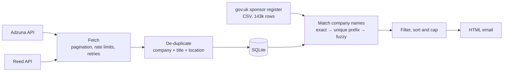

# Grady

[](https://github.com/hjeesum/grady/actions/workflows/tests.yml)

**A daily email of new graduate and junior tech jobs in the UK, only from employers licensed to sponsor visas.**

## The problem

As an international computer science graduate job hunting in the UK, I need an employer that can sponsor a Skilled Worker visa. Job sites don't let you filter for that. I kept finding a promising role, researching the company, sometimes starting an application, and only then discovering the employer couldn't sponsor me.

The UK government publishes the [Register of Licensed Sponsors](https://www.gov.uk/government/publications/register-of-licensed-sponsors-workers): every organisation allowed to sponsor workers. Grady checks every job against it automatically, so I only spend time on jobs I can actually take.

## What it does

Every morning, a GitHub Actions workflow:

1. **Searches** the Adzuna and Reed job APIs across the whole UK, plus NHS Jobs for healthcare.
2. **Removes duplicates**: the same job reposted, or listed on both sites.
3. **Checks each employer** against the 128,000 names on the sponsor register.
4. **Filters** out senior roles, non-tech roles and low salaries.
5. **Emails me** only the jobs I haven't seen before, preferred cities first.


*An example digest. The companies and jobs in this screenshot are made up.*

Recruitment agencies get their own section. Their adverts hide the real employer, so sponsorship can't be checked automatically.

## How it works



| Part | File | Notes |
|---|---|---|
| Job sources | [`adzuna.py`](grady/adzuna.py), [`reed.py`](grady/reed.py), [`nhs_jobs.py`](grady/nhs_jobs.py) | Official APIs and feeds only, no scraping. Each converts results into one `Job` type, so adding a source is one new file. NHS Jobs is searched for Band 5 (entry-level) roles only. |
| HTTP | [`http_utils.py`](grady/http_utils.py), [`ratelimit.py`](grady/ratelimit.py) | Requests spaced 2.5 s apart; 429 and 5xx retried with exponential backoff. API keys never appear in error messages. |
| Storage | [`storage.py`](grady/storage.py) | SQLite with a `UNIQUE(source, source_id)` constraint and versioned schema migrations. |
| Sponsor register | [`sponsors.py`](grady/sponsors.py) | Finds today's CSV through the GOV.UK Content API, since the file name changes with every update. |
| Matching | [`normalise.py`](grady/normalise.py), [`matching.py`](grady/matching.py), [`agencies.py`](grady/agencies.py) | See "Challenges" below. |
| Email | [`digest.py`](grady/digest.py), [`emailer.py`](grady/emailer.py) | Jinja2 template with autoescaping, HTML + plain text, sent over SMTP with STARTTLS. |
| Automation | [`.github/workflows/`](.github/workflows) | Tests on every push; the digest runs daily at 06:37 UTC (off the hour, when GitHub is less busy). |

## Challenges

### 1. Matching company names to the sponsor register

This was the hardest part. A job advert says `Tarmac`; the register says `Tarmac Trading Limited`. An advert says `Leonardo Hotels`; the register has `Leonardo UK Ltd`, a defence company. Get it wrong one way and I miss jobs. Get it wrong the other way and I apply to employers that can't sponsor me, which is the exact problem this project exists to solve.

**Normalising** names (lowercase, strip `Ltd`/`PLC`/`UK` from the end, `&` → `and`) let exact matching find 18 of 74 companies in my real data. To do better, I built a **labelled set of 50 real company names** with the right answer for each. It deliberately includes look-alikes, such as `Express Solicitors` vs `Expert Solicitors`. I then measured each approach against it:

- **rapidfuzz's `token_set_ratio`** matched `A1 Personnel Employment Agency` to a company called just `agency`: 10 or more wrong matches at every threshold.
- **Stripping generic words** ("recruitment", "solutions") before comparing was my own idea, and it made things worse: `Express Solicitors` and `Express Solutions` both became `express`. Those words were what told the companies apart.
- **The final approach** is a sequence, from safest to riskiest:
  1. **Exact** match on normalised names.
  2. **Unique prefix**: `Tarmac` matches `Tarmac Trading Limited` only if *exactly one* register company starts with those words. If several do, it doesn't guess.
  3. **Fuzzy** whole-name similarity of at least 95, for typos.

**Choosing the threshold.** A threshold of 93 scored perfectly on the labelled set. But the closest correct match (93.6) sat just 0.7 points above a wrong one (92.9), which is overfitting to one example. I chose **95**: 17 of 18 correct and **0 wrong**, because missing a job costs less than a wasted application. [`scripts/evaluate_matching.py`](scripts/evaluate_matching.py) re-runs the measurement, and a test fails if any labelled company is ever matched wrongly.

### 2. Recruitment agencies

More than half of the adverts in my data came from agencies, which hide the employer. Some agencies, such as Hays, are licensed sponsors themselves, but that says nothing about their client. So agencies are detected (by name keywords and a configurable list) **before** sponsor matching and shown separately.

### 3. The same job on two sites

Reed gives about 60% of locations as postcodes (`LS13AD`), while Adzuna gives place names (`Holbeck, Leeds`), so cross-site duplicates never matched. Postcodes are converted with [postcodes.io](https://postcodes.io), and two locations count as the same place if they share a part (`Leeds`). That rule also merged one agency's copies of the same advert posted separately for each London borough.

### 4. Healthcare: going to the source

Adzuna and Reed found only about 6 entry-level healthcare jobs a week at sponsors, because most NHS vacancies are posted on NHS Jobs. Its public search feed (documented for developers to "make use of the data") can filter by **NHS pay band**. That matters because NHS seniority is set by band, not by words like "senior" in the title: Band 5 is entry level for nurses and allied health professionals. Searching Band 5 only raised the count to about 250 a week.

The register and NHS Jobs also name trusts differently ("Barts Health National Health Service Trust" vs "Barts Health NHS Trust", "NHS FT" vs "NHS Foundation Trust"). Treating these NHS organisation types as legal suffixes, like "Ltd", raised matched NHS employers from 81% to 89%, with no change to the labelled-set results.

### 5. Running unattended

- **No server, and no database between runs.** Each GitHub Actions run starts on a fresh machine, so the SQLite file lives on a separate one-commit `data` branch: restored at the start of a run, saved at the end.
- **Failures are expected.** Adzuna returned HTTP 503 during development and crashed the whole run, so one failing source is now skipped. A source that fails for *every* search term (like a wrong API key) still finishes the run but marks it failed, so GitHub alerts me.
- **Jobs are marked as emailed only after the email is sent.** If sending fails, the same jobs go out the next day instead of being lost.

## Testing

88 pytest tests cover name normalisation, sponsor matching (including the look-alike traps), de-duplication, database migrations, API response parsing, filters and email rendering. They make no network calls: APIs are replaced with sample JSON, and the email server with a fake SMTP class.

To check the tests can actually catch bugs, I introduced deliberate ones: lowering the threshold, letting the prefix rule guess, checking agencies after sponsors, and turning off HTML escaping. Each was caught by the test written for it.

```
python -m pytest
```

## Run it yourself

Requires Python 3.13 and free API keys from [Adzuna](https://developer.adzuna.com/) and [Reed](https://www.reed.co.uk/developers).

```
python -m venv .venv
.venv\Scripts\activate             # Windows; on macOS/Linux: source .venv/bin/activate
pip install -r requirements-dev.txt
copy .env.example .env             # then fill in your keys (macOS/Linux: cp)
python -m grady --dry-run          # fetch, and build a preview per profile in data/previews/, without sending
```

Search terms, preferred cities, salary and keyword filters live in [`config.yaml`](config.yaml), as **profiles**: tech, healthcare, engineering, finance, law and graduate schemes. Every profile's search terms are fetched once per run, and each profile then picks its own jobs with its own filters, so API usage grows with the number of search terms, not the number of profiles. `my_profile` chooses which digest is emailed.

To run it daily on GitHub, add `ADZUNA_APP_ID`, `ADZUNA_APP_KEY`, `REED_API_KEY`, `SMTP_USER`, `SMTP_PASSWORD` (a Gmail App Password) and `EMAIL_TO` as repository secrets.

## Limitations

- **A licence isn't a guarantee.** The register shows an employer *can* sponsor, not that they will for a given role. The role must also meet Skilled Worker rules, such as salary thresholds and eligible occupations. Always confirm with the employer.
- **Remote/hybrid detection is a guess**, made from the short advert snippet the APIs return. Most jobs show as "unknown".
- **Some sponsors are missed on purpose.** When a brand name differs completely from the legal name, matching leaves it out rather than guess.

## Future improvements

- Re-check previously rejected companies when the sponsor register updates.
- Match the remaining NHS naming variants (e.g. "… Hospital NHS Foundation Trust", Welsh health boards), adding them to the labelled set first.
- Add company job boards (Greenhouse, Lever, Ashby) as a source: jobs straight from employers on the sponsor register.
- Use full advert text to spot "no sponsorship available" phrases.
- Check roles against Skilled Worker salary thresholds and occupation codes.
- Tune search terms and use each API's IT category, to bring in more tech roles.
- A small web page to browse past jobs and mark ones I've applied to.

## Tech

Python 3.13 · requests · SQLite · rapidfuzz · Jinja2 · pytest · GitHub Actions
